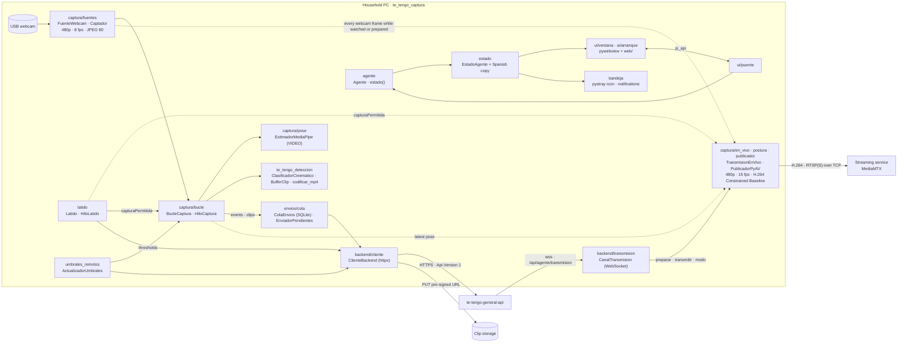

# Internal architecture

Te Tengo Captura is one Python process on the household PC. It reads the USB webcam, estimates the pose with MediaPipe on the CPU, classifies the movement with the validated kinematic classifier and sends **events and 6 s + 6 s clips** to `te-tengo-general-api` ([AGENT_CONTRACT.md](AGENT_CONTRACT.md)). Only while a family member watches the live view does it publish video, to the streaming service (MediaMTX) the API points it to. A small window and the system tray show the state. ADR 0007 explains why the processing moved from the cloud to the PC.

## Principles

1. **Two packages, one rule.** `te_tengo_deteccion` is the validated detection core: pure Python, no GUI, no network. It never imports `te_tengo_captura`, pywebview, pystray or httpx (`tests/test_dependencias.py`). `te_tengo_captura` is the desktop application around it.
2. **Same processing as the validation.** 480p, 8 fps sampled by time, JPEG quality 80, pose estimated on the decoded JPEG, MediaPipe in VIDEO mode ([validation.md](validation.md), section 2; ADR 0006).
3. **Ports and fakes.** Every outside dependency comes in through a small protocol with a fake for tests: `FuenteVideo` (`FuenteFalsa`, `FuenteArchivo`), `Estimador`, the backend (`BackendFalso` on `httpx.MockTransport`), `TransmisorEnVivo` and `Publicador` (live view), the control channel's `connect`, and the `webview` and `pystray` modules (replaced in `sys.modules`).
4. **Threads, not globals.** pywebview owns the main thread. Capture (with MediaPipe), heartbeat, outbox, remote thresholds, the state notifier, the live view publisher and its control channel each run in a worker thread. The UI receives the state through subscriptions and the JS bridge.
5. **Hard gates and no lost events.** Without consent or during a pause the webcam is closed (CA-05.2, CA-22.1). Every event goes to a persistent outbox before it is sent.

## Components



## Modules

```
src/te_tengo_deteccion/          VALIDATED CORE (logic unchanged since the validation)
├── clasificacion/               parameters (Chen et al., 2020), thresholds, state machine
├── pose/                        MediaPipe landmarker (VIDEO mode) and the Pose type
└── clips/                       6 s + 6 s BufferClip and codificar_mp4 (PyAV, ADR 0008)

src/te_tengo_captura/
├── __main__.py                  entry point: arguments, single instance, logging, autostart
├── config.py                    fixed TOML installation file (platformdirs or --config)
├── coordinador.py               installation, linking or linked PC, and the moves between them; state notifier
├── agente.py                    an installation's camera: builds and runs its worker threads
├── agente_pc.py                 a linked PC: its heartbeat, control channel, cameras and unlink
├── camaras.py                   a linked PC's cameras: inventory, the owner's assignments, one agent each
├── diario.py                    advanced mode: plain-language live log (logging handler, ring buffer), meters
├── actividad.py                 the PC's append-only activity log, sent to the API
├── diagnostico.py               «Exportar diagnóstico»: zip without secrets, images or landmarks
├── almacen/                     «Almacenamiento»: movements (Parquet+zstd), video, clips; AES-GCM at rest, SQLite index, retention and space limit (US-38, US-35); «Ver qué pasó» from them (US-39)
├── actualizaciones/             updates (US-43): GET /api/versiones, download + SHA-256, silent install, waits, 03:00
├── vinculacion/                 PC link: OAuth device grant, keychain store, session, QR (US-28, US-31)
├── estado.py                    EstadoAgente: priority and Spanish copy of the window and tray
├── sistema.py                   the PC's name and operating system (window, PC link)
├── latido.py                    heartbeat every 30 s; consent, pause and room name
├── umbrales_remotos.py          GET /api/agente/configuracion, hourly
├── backend/                     ClienteBackend, typed errors, BackendFalso, live view control channel
├── captura/                     sources, sampling, MediaPipe estimator, capture loop, live view
├── envios/                      persistent outbox (SQLite) and its sender thread
├── ui/                          splash, window (tabs Estado · Cámaras), JS bridge; web/ (HTML, CSS, JS, Poppins)
├── bandeja/                     tray icon images, menu and notifications
├── salida.py                    bounded exit: stray non-daemon threads never keep the process alive; 8 s watchdog
├── instancia.py                 single instance (file lock + loopback socket; a named mutex on Windows for the installer)
├── autoinicio.py                per-user Run registry entry on Windows
├── registro.py                  rotating logs without secrets
├── autoprueba.py                --autoprueba: smoke test of a build
└── sin_interfaz.py              --sin-interfaz: the agent without window or tray (end-to-end test)
```

## Flows

**A frame** (capture thread, about 8 times per second):
1. `Captador.leer` reads the webcam and keeps one frame every 1/8 s. It downscales the frame to 480p, compresses it to JPEG 80 and decodes it again.
2. `BucleCaptura.paso` checks the gate (`Latido.captura_permitida`); without permission it closes the webcam, drops the clip buffer and resets the classifier.
3. The frame enters the clip buffer; `EstimadorMediaPipe` returns the pose; `ClasificadorCinematico.actualizar` returns the events.
4. Each event gets a UUID v7 `eventoId` and is written to the outbox; `caida` and `movimiento_inestable` also mark a clip. Six seconds later the clip is encoded off the loop thread and written to the outbox (CA-18.1). If encoding fails, the event still goes out (CA-18.2).

**An event to the backend** (outbox thread): `ColaEnvios.enviar` sends pending events in order with `POST /api/agente/eventos`, urgent ones (fall, confirmed fall, unstable movement, recovery) first; a `200` duplicate counts as delivered. Then, for each clip whose event was accepted, it requests the upload URL and `PUT`s the MP4, deleting the file afterwards. After each clip, the landmarks of its 12 seconds (US-36, Parquet, made by the camera's `GrabadorCamara` from its last 20 s of rows, only with the movement consent) go to `POST …/clip/puntos` and its pre-signed URL. Last, and only when no event or clip is waiting, the movements lane (`envios/movimientos.py`, US-37) uploads the camera's 5-minute files the cloud does not have yet: decrypted from the data folder, `POST /api/agente/movimientos` with size, SHA-256 and rows, `PUT`, confirmation; then the index marks it, or deletes it if it was only written for the cloud. Urgent events, the other events, the clips and the movement files each have their own backoff, so a failing clip upload never delays an event: after a failure that may succeed later, a lane waits 2 s, doubling up to 300 s (5 s for urgent events, and a new urgent event is tried at once) with jitter.

**Capture state** (heartbeat thread): every 30 s, or as soon as the webcam state changes, `POST /api/agente/senal` reports `webcamConectada` and `deteccionConfiable`. The answer updates consent, pause and room name. The state is stored on disk, so an offline restart honours it, and a pause ends on its own at its hour (CA-22.3). Offline, the heartbeat retries at 2, 4, 8 and 16 s, then every 30 s, and the window shows the countdown.

**The window** (notifier thread → main thread): every second `Agente.estado()` derives an immutable `EstadoAgente` from the cameras of the PC. Its summary (`health`) has the priority a camera does not answer › no internet › no consent › a camera paused › someone watching live › all good, and each camera has its own row (`camStatus`). The window gets it with `ttg.actualizar(...)` and renders the tabs «Estado» and «Cámaras» of the synthesized prototype; the tray updates its dot (green, grey, amber, violet while someone watches) and tooltip, and `Avisos` decides the system notifications. The page only patches the countdown in place, so it never moves the focus. In «Cámaras» the window asks four times per second for the selected camera's preview (`vistaPrevia`): `VistaPreviaLocal` keeps the newest webcam frame in memory only while it is asked for and returns a small JPEG; nothing is written to disk or sent. For a camera in use, «Qué se ve» («Video», «Esqueleto», as the app's live view; only video by default, remembered in `ventana.json`) draws the capture loop's latest pose with the live view's `postura.componer`: the frame with the skeleton, or the skeleton alone on the brand purple.

**Live view** (control channel and publisher threads, US-23): `CanalTransmision` keeps the WebSocket `/api/agente/transmision` open with the camera token. On `{"transmitir":true,…}` `Captador` starts handing every frame the webcam delivers to `TransmisionEnVivo` (`ofrecer`, before the 8 fps detection sampling, which does not change), and the capture loop hands it each estimated pose (`anotar_pose`). `Ritmo` keeps one frame per slot of a 15 fps grid (configurable, `[vista_en_vivo] fps`) and the frame is only queued (two frames; the oldest is dropped when behind). The worker downscales it to 480p, draws the picture for the mode from the latest pose (`postura.componer`: the frame, the frame with the skeleton, or the skeleton alone on the brand purple with no camera pixels) and `PublicadorPyAV` encodes it as H.264 Constrained Baseline (keyframe every 0.5 s, the first frame of every publication included) and publishes it to `urlPublicacion` over RTSP/TCP. `{"preparar":true}` (the app opened the camera screen) warms everything local for up to 60 s without sending anything: PyAV and libx264 loaded and run once on a grey picture, the webcam frames flowing at 15 fps with only the newest kept in memory, the last publish host resolved again; `transmitir` then publishes that newest frame at once. `{"transmitir":false}`, a closed channel, or capture no longer allowed (the loop calls `suspender` and the worker checks the gate) close the publisher and drop the warm state at once. A failed publish retries at 1 s doubling up to 30 s. `--marca-tiempo` (or `[vista_en_vivo] marca_tiempo`) draws the capture time in milliseconds on the published picture, to measure glass-to-glass latency.

**PC link** (US-28, US-31, ADR 0009 of the API): with no installation credential, `Coordinador` starts `Vinculador` (`vinculacion/maquina.py`), which asks for a code and polls the token endpoint every `interval` (adding 5 s on `slow_down`, asking for a new code on `expired_token`/`invalid_grant`, stopping on `access_denied`). On approval the tokens go to the OS credential store (`vinculacion/credenciales.py`) and `AgentePc` starts: `SesionPc` renews the access token five minutes before it expires with the rotating refresh token (one at a time, never presenting a used one), `LatidoPc` sends `POST /api/agente/pc/senal` every 30 s and a `CanalTransmision` with the PC's token hears `{"desvincular":true}`. Any unlink signal (that message, `401 PC_DESVINCULADA`, `invalid_grant`) reaches `Coordinador._al_desvincular`, which stops capture at once, then in its own thread stops the threads, deletes the credentials and the outbox state, and shows «Esta PC se quitó…». An installation's `Agente` reports the same signals.

**Cameras of a linked PC** (US-29): `SupervisorCamaras` lists the webcams every 5 s (`captura/dispositivos.py`, by the OS unique id) and sends the whole inventory when the set changes. The API answers every webcam of the PC with its room and, for those in use, a token; the supervisor starts one `Agente` per camera in use (its own `FuenteWebcamPorId`, which resolves the OpenCV index from the id each time it opens, its own `EstimadorMediaPipe` in VIDEO mode, outbox in `camaras/<camaraId>/`, heartbeat, live view and channel) and stops the others. `{"camara":…}` on the PC's channel and `GET …/camaras` after every reconnection feed the same reconciliation. A camera's `401` asks the PC's `SesionPc` for new tokens (`POST …/camaras/tokens`, also run after every renewal of the PC's tokens); a camera's `401 PC_DESVINCULADA` or `desvincular` only means that camera left its room unless the PC's own token says the PC left.

**Advanced mode** (US-32 to US-34): `BucleCaptura` hands every analysed frame (`Analisis`: frame, pose, classifier, events) to its observers. Each camera's `Narrador` turns the analysis and the connection changes into plain-language log records with `extra={"diario": …}`; `ManejadorDiario` (a handler on the root logger) keeps them in `Diario`'s ring buffer per camera only while the mode is on, and the window reads the new lines twice per second. `Narrador` also keeps the latest `Medicion` for the meters. `RegistroActividad` appends the PC's changes to `actividad.jsonl` and sends the API's types after each PC heartbeat.

**Local storage** (US-38, US-35; `almacen/`): `AlmacenLocal` owns the data folder (by default `Datos` in the platform's data directory; «Cambiar carpeta» moves it in a background thread), the settings (`almacenamiento.json`) and the SQLite index of every file by camera, type and time. Each camera's `GrabadorCamara` is one more observer of its `BucleCaptura`: it only queues the analysis (rows and, with continuous video on, frames; a full queue drops instead of waiting) and its writer thread does the rest. Movements are one Parquet+zstd file per camera every 5 minutes (`puntos.py`: the 33 points quantized to `uint16`/`int16`/`uint8` with delta encoding, plus `t_ms`, `pose_presente`, θ, P, v, the phase and the event) and are written only while `GET /api/agente/movimientos/estado` (at start and every 5 minutes) says `guardarEnLaPc`; when that ends the window asks whether to delete what the PC kept. Continuous video (off by default) is H.264 480p at 8 fps in 10-minute fragmented MP4 parts written straight into the encrypted file, timestamped in milliseconds since the part started (always increasing, so uneven, repeated or earlier capture instants never give the muxer a non-increasing DTS); a part that fails is closed with what it has, logged once, and the next one opens 30 s later, and at start the encrypted files a forced exit left half-written (`.*.ttg.*.tmp`, untouched for 15 min) are deleted; clips keep a local copy of each alert's 12 s. Every file is AES-256-GCM in 1 MiB chunks (`cifrado.py`) with a key kept in the OS credential store, so no plaintext reaches the disk. Before each file the space limit deletes the oldest video, then the oldest movements (`retencion.py`); the retention per type runs hourly and right after a change. Nothing here ever slows detection down: if the folder is gone or the disk is full, the file is skipped and «Almacenamiento» says so.

**«Ver qué pasó»** (US-39, `almacen/repeticion.py`): only with the movement consent, the window asks for a 10-minute or 1-hour window of a camera (its events, read from each row's event; its stretches without data: no file or no rows, «Sin captura», and rows without a person, «Sin persona»; whether there is continuous video) and then the poses in 2-minute chunks (the 13 joints the skeleton draws and a phase code per row). Playback runs in the page on a real-time clock at 0.5×–4× and skips the stretches without data. «Sobre el video guardado» asks for the frame at the current time: the encrypted 10-minute segment is decrypted in memory and decoded forward from the last frame (a seek otherwise). Closing a replay that was played or scrubbed writes «Desde esta PC: se vio qué pasó en …» in the PC's activity log (CA-39.3).

**Updates** (US-43, `actualizaciones/`): `Actualizador` runs one thread that every second checks whether the daily `GET /api/versiones` is due (`backend/versiones.py`, no token; at startup, then every 24 h, an hour later without internet), whether an update that waited can go on, and whether it is the night window of «Actualizar automáticamente» (03:00–06:00, Windows, once per night). «Descargar» runs `descarga.descargar` in its own thread: a disk space check, the streamed download with its percentage and «Cancelar», then the SHA-256 of the file against the API's. When `Coordinador.motivo_de_espera` says a fall alert is in progress (`alerta.SeguimientoAlerta`, fed by each camera's analysed events) or a live view, pre-warm or preview is open, the verified installer waits. Then `instalador.lanzar` starts it detached with `/RELANZAR` and the application exits; the installer waits for the named mutex to disappear, installs and opens the new version, whose first start deletes the installer and records `PC_ACTUALIZADA`. The window shows the band and «Acerca de» from `upd` in the state; the tray icon gets a coral dot and its menu items; `Avisos` sends one system notice per version.

**Startup**: single-instance check → logging → configuration → agent → splash (real steps: threads, webcam, first heartbeat) → status window. Closing or minimizing hides the window to the tray; «Salir» in the tray menu (on a Mac also Cmd+Q, the app menu and the Dock, `ui/macos.py`) opens the window and asks to confirm, then stops everything. **The exit is bounded** (`salida.py`): the confirmed «Salir» returns to the page at once and the window closes 0.3 s later, so no JS bridge call is left waiting for a window that is gone; when pywebview's main loop ends the tray and the agent stop, and `main` releases the single-instance lock and then ends the process without waiting for pywebview's non-daemon bridge threads (2 s at most, logged). A watchdog started with the exit ends the process after 8 s whatever is stuck, logging every thread's stack. Logging out or shutting down never asks: on a Mac the app answers `NSTerminateLater`, stops the agent and terminates; on Windows the forms close with `CloseReason.WindowsShutDown` (`ui/windows.py`). `--salir-tras S` runs the tray «Salir» and the window's confirmation S seconds after the window opens: the Windows package job checks that the process ends within 5 s. «Restablecer esta PC» (`Coordinador.restablecer`, `restablecer.py`) unlinks the PC with `motivo=restablecida`, deletes its credentials, `config.toml`, the data folder and the start with the system, and shows the link code; `te-tengo-captura --restablecer` does the same without a window for the Windows uninstaller (`motivo=desinstalada`), and «Desinstalar» on a Mac adds the move of the `.app` to the Trash.

## Decisions and their records

| Topic | Where |
|---|---|
| Processing on the PC, the server retired | [ADR 0007](adr/0007-processing-on-household-pc.md) |
| MediaPipe in VIDEO mode | [ADR 0006](adr/0006-mediapipe-video-mode.md) |
| Clips with PyAV | [ADR 0008](adr/0008-clip-encoding-with-pyav.md) |
| Live view through MediaMTX | [AGENT_CONTRACT.md](AGENT_CONTRACT.md), "Live view"; `captura/en_vivo.py` and `backend/transmision.py` docstrings |
| Thresholds and their sources | [classification-spec.md](classification-spec.md), [ADR 0004](adr/0004-chen-thresholds.md) |
| Implementation choices (backoffs, intervals, timeouts) | the docstring of each module: `envios/cola.py`, `latido.py`, `captura/fuentes.py`, `captura/bucle.py`, `captura/en_vivo.py`, `captura/publicador.py`, `backend/transmision.py`, `umbrales_remotos.py`, `ui/arranque.py` |
| Open questions for the team | [BLOCKERS.md](BLOCKERS.md) |

## References

Chen, W., Jiang, Z., Guo, H., & Ni, X. (2020). Fall detection based on key points of human-skeleton using OpenPose. *Symmetry, 12*(5), 744. https://doi.org/10.3390/sym12050744

Cockburn, A. (2005). *Hexagonal architecture*. https://alistair.cockburn.us/hexagonal-architecture/

Python Packaging Authority. (s.f.). *src layout vs flat layout*. https://packaging.python.org/en/latest/discussions/src-layout-vs-flat-layout/
