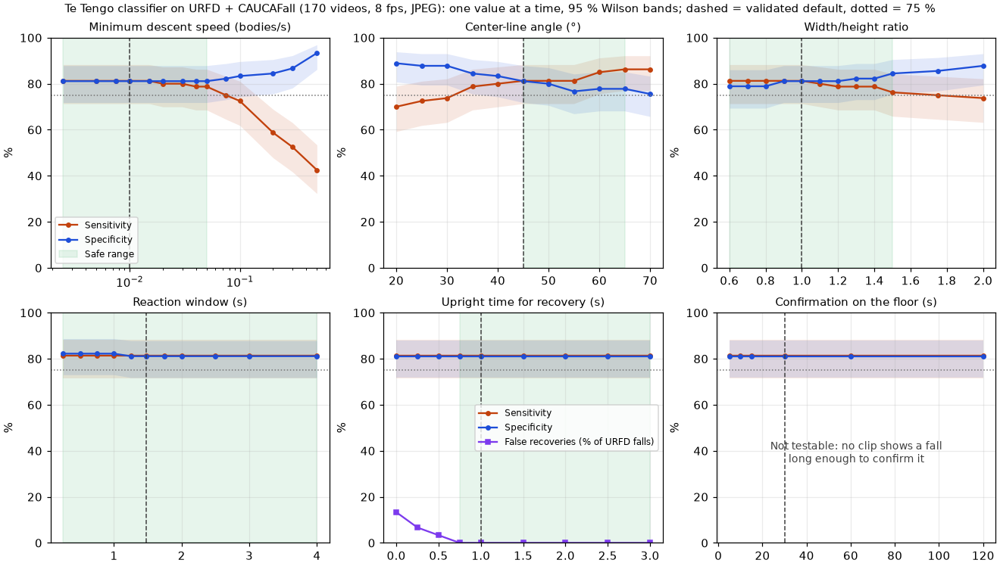

# Safe ranges of the tunable classification values

US-45 («Ajustar la detección por cámara») lets the installer change six values of the classifier for one camera, but only **inside a safe range with its origin** (CA-45.1, CA-45.2). This document measures those ranges with the same public datasets and the same production conditions as [validation.md](validation.md), and says which part of each range is backed by data and which is not.

To reproduce it:

```bash
make datasets                                   # URFD and CAUCAFall into datos/
uv run python scripts/evaluar.py extraer        # once: stores the poses (8 fps, JPEG, VIDEO mode)
uv run python scripts/barrer_rangos.py --grafico docs/img/validacion-rangos.png
```

`scripts/barrer_rangos.py` replays the stored poses (about 7 s for 400 settings) and writes the full tables to `resultados/rangos/rangos.md` and `rangos.csv`.

## 1. Method

1. **Same data and processing as the validation** (validation.md, sections 1 and 2): 170 videos (URFD 30 falls + 40 daily activities; CAUCAFall 50 + 50), 480p, 8 fps, JPEG quality 80, MediaPipe Pose Landmarker *lite* in VIDEO mode, replayed in the agent's `ClasificadorCinematico`. The poses are extracted once and cached, so each setting is only a replay.
2. **Per-video criterion**, as in the validation: a fall video is a true positive if it has at least one `caida`; a daily activity with a `caida` is a false positive.
3. **Settings.**
   - *One value at a time:* each of the six values is moved over a list that covers the proposed range with margin on both sides; the other five stay at the validated defaults (0.01 bodies/s, 45°, 1, 1.48 s, 30 s, 1 s).
   - *Grid of the three values that decide a fall together* (M1, M2 and M3): speed {0.005, 0.01, 0.02, 0.03, 0.05} × angle {30, 40, 45, 50, 55, 60} × ratio {0.8 … 1.5 in steps of 0.1} = 240 combinations, because the installer can change all three at once.
4. **Metrics.** Sensitivity, specificity and accuracy with **95 % Wilson score intervals** (Wilson, 1927); **false recoveries** (URFD falls with a `recuperacion`: nobody gets up in them, per their per-frame labels); `movimiento_inestable` in daily activities; and **detection latency** = instant of the first `caida` minus the first URFD frame labelled "falling" (label 0 of `urfall-cam0-falls.csv`, 30 fps). CAUCAFall has no per-frame labels in the downloaded files, so latency is measured on the 30 URFD falls only.
5. **Safe range.** A tested value is *safe* if sensitivity ≥ 75 % and specificity ≥ 75 %, neither is more than 5 points below the default, and there are no more false recoveries than with the default (0 of 30). The measured range of a value is the run of consecutive safe values that contains the default. For the three interacting values the recommended range is the **largest box of grid values in which every combination is safe**.

**What kind of evidence this is.** The default row is the same figure as the honest leave-one-group-out estimate of validation.md (81.2 % / 81.1 %), because every fold calibrates the same speed threshold (0.01). The sweeps are a **sensitivity analysis** of fixed settings on the same 170 videos, not a new calibration. With 80 falls and 90 activities, one video is 1.2 points of sensitivity or 1.1 points of specificity, and the 95 % intervals are about ±8 points wide; differences of one or two videos between settings are not significant. The ranges say where the performance **does not break** on these data, not that the values inside are equivalent in a home.

## 2. Results



### 2.1. Recommended ranges

| Value (`[clasificacion]`) | Default | Proposed (US-45) | Measured, one at a time | **Recommended** | Evidence |
|---|---|---|---|---|---|
| `velocidad_descenso_min` | 0.01 bodies/s | 0.005–0.05 | 0.0025–0.05 | **0.005–0.05** | Data. Above 0.05 sensitivity falls (75.0 % at 0.075, 58.8 % at 0.2). Jointly safe with the angle and ratio ranges below. |
| `angulo_linea_central_max_grados` | 45° | 30–60° | 45–65° | **45–60°** | Data. Below 45° the "upright" test of R5 gets looser: 35° and 40° give 1 false recovery in 30, and at 30° sensitivity drops to 73.8 %. The proposed lower end (30°) is **not safe**. |
| `razon_ancho_alto_min` | 1 | 0.8–1.5 | 0.6–1.5 | **1.0–1.4** | Data. Alone, 0.6–1.5 is safe, but combined: a ratio below 1 with an angle of 55–60° gives specificity 73–76 %, and 1.5 with a speed ≥ 0.02 gives sensitivity ≤ 75 %. |
| `ventana_reaccion_s` | 1.48 s | 1.0–3.0 s | 0.25–4 s (flat) | **1.0–3.0 s** | Partly. The clips cannot tell the values apart (81.2 % / 81.1–82.2 % everywhere), because with v = 0.01 R4 re-arms on every frame in which the hip goes down and the body is tilted. The bounds come from the source: a fall without reaction takes 1.0–1.48 s (Gutiérrez et al., 2023); the upper end allows slower falls. The effect of a long window on false alarms over a whole day is **untested**. |
| `confirmacion_suelo_s` | 30 s | 15–120 s | — | **15–120 s** | **Untested.** No clip lasts long enough: a detected fall is on video for at most 9.5 s after `caida`, so no `caida_confirmada` is ever emitted. It only delays the confirmation (R6); it never changes whether `caida` is sent. The default comes from the backlog (US-13). |
| `persistencia_erguido_s` | 1 s | 0.5–3 s | 0.75–3 s | **0.75–3 s** | Data for the lower end: 0, 0.25 and 0.5 s give 4, 2 and 1 false recoveries in 30 URFD falls; from 0.75 s, none. The upper end only delays the `recuperacion`; **no clip has a labelled real recovery**, so how long a real one takes to be accepted is untested. |

Inside the recommended box (speed 0.005–0.05 × angle 45–60 × ratio 1.0–1.4, 100 grid combinations) the worst cases are sensitivity 76.2 % (0.05, 45°, 1.2) and specificity 76.7 % (55°, 1.0); every combination keeps 0 false recoveries. The detection latency stays at a median of 0.80–0.83 s (0.47–2.03 s) in every safe setting, far below the 10 s budget of an alert (CA-11.3), most of which is left to the network and the push.

### 2.2. Default

| Setting | Sensitivity (95 % CI) | Specificity (95 % CI) | Accuracy (95 % CI) | FN | FP | False recoveries | Latency s, median (min–max) |
|---|---|---|---|---|---|---|---|
| Defaults | 81.2 % (71–88 %) | 81.1 % (72–88 %) | 81.2 % (75–86 %) | 15 | 17 | 0/30 | 0.83 (0.47–2.03) |

### 2.3. One value at a time

**Minimum descent speed (R1), bodies/s**

| Value | Sensitivity (95 % CI) | Specificity (95 % CI) | Accuracy | FN | FP | False rec. | Safe |
|---|---|---|---|---|---|---|---|
| 0.0025 | 81.2 % (71–88) | 81.1 % (72–88) | 81.2 % | 15 | 17 | 0 | yes |
| 0.005 | 81.2 % (71–88) | 81.1 % (72–88) | 81.2 % | 15 | 17 | 0 | yes |
| **0.01** | 81.2 % (71–88) | 81.1 % (72–88) | 81.2 % | 15 | 17 | 0 | yes |
| 0.02 | 80.0 % (70–87) | 81.1 % (72–88) | 80.6 % | 16 | 17 | 0 | yes |
| 0.03 | 80.0 % (70–87) | 81.1 % (72–88) | 80.6 % | 16 | 17 | 0 | yes |
| 0.05 | 78.8 % (69–86) | 81.1 % (72–88) | 80.0 % | 17 | 17 | 0 | yes |
| 0.075 | 75.0 % (65–83) | 82.2 % (73–89) | 78.8 % | 20 | 16 | 0 | no |
| 0.1 | 72.5 % (62–81) | 83.3 % (74–90) | 78.2 % | 22 | 15 | 0 | no |
| 0.2 | 58.8 % (48–69) | 84.4 % (76–91) | 72.4 % | 33 | 14 | 0 | no |
| 0.5 | 42.5 % (32–53) | 93.3 % (86–97) | 69.4 % | 46 | 6 | 0 | no |

**Center-line angle (R2, also the "upright" test of R5 and R7), degrees**

| Value | Sensitivity (95 % CI) | Specificity (95 % CI) | Accuracy | FN | FP | False rec. | Safe |
|---|---|---|---|---|---|---|---|
| 25 | 72.5 % (62–81) | 87.8 % (79–93) | 80.6 % | 22 | 11 | 0 | no |
| 30 | 73.8 % (63–82) | 87.8 % (79–93) | 81.2 % | 21 | 11 | 0 | no |
| 35 | 78.8 % (69–86) | 84.4 % (76–91) | 81.8 % | 17 | 14 | 1 | no |
| 40 | 80.0 % (70–87) | 83.3 % (74–90) | 81.8 % | 16 | 15 | 1 | no |
| **45** | 81.2 % (71–88) | 81.1 % (72–88) | 81.2 % | 15 | 17 | 0 | yes |
| 50 | 81.2 % (71–88) | 80.0 % (71–87) | 80.6 % | 15 | 18 | 0 | yes |
| 55 | 81.2 % (71–88) | 76.7 % (67–84) | 78.8 % | 15 | 21 | 0 | yes |
| 60 | 85.0 % (76–91) | 77.8 % (68–85) | 81.2 % | 12 | 20 | 0 | yes |
| 65 | 86.2 % (77–92) | 77.8 % (68–85) | 81.8 % | 11 | 20 | 0 | yes |
| 70 | 86.2 % (77–92) | 75.6 % (66–83) | 80.6 % | 11 | 22 | 0 | no |

**Width/height ratio (R3, also R5)**

| Value | Sensitivity (95 % CI) | Specificity (95 % CI) | Accuracy | FN | FP | False rec. | Safe |
|---|---|---|---|---|---|---|---|
| 0.6–0.8 | 81.2 % (71–88) | 78.9 % (69–86) | 80.0 % | 15 | 19 | 0 | yes |
| 0.9 | 81.2 % (71–88) | 81.1 % (72–88) | 81.2 % | 15 | 17 | 0 | yes |
| **1** | 81.2 % (71–88) | 81.1 % (72–88) | 81.2 % | 15 | 17 | 0 | yes |
| 1.1 | 80.0 % (70–87) | 81.1 % (72–88) | 80.6 % | 16 | 17 | 0 | yes |
| 1.2 | 78.8 % (69–86) | 81.1 % (72–88) | 80.0 % | 17 | 17 | 0 | yes |
| 1.3–1.4 | 78.8 % (69–86) | 82.2 % (73–89) | 80.6 % | 17 | 16 | 0 | yes |
| 1.5 | 76.2 % (66–84) | 84.4 % (76–91) | 80.6 % | 19 | 14 | 0 | yes |
| 1.75 | 75.0 % (65–83) | 85.6 % (77–91) | 80.6 % | 20 | 13 | 0 | no |
| 2 | 73.8 % (63–82) | 87.8 % (79–93) | 81.2 % | 21 | 11 | 0 | no |

**Reaction window (R4, R7), seconds:** 0.25–1.0 s give 81.2 % / 82.2 % (one false alarm fewer); 1.25–4.0 s give 81.2 % / 81.1 %. No change in false recoveries (0) or latency.

**Confirmation on the floor (R6), seconds:** 5–120 s give identical results (81.2 % / 81.1 %, 0 false recoveries) because `caida` does not depend on it and no clip reaches a confirmation.

**Upright time for recovery (R5), seconds**

| Value | 0 | 0.25 | 0.5 | 0.75 | **1** | 1.5 | 2 | 2.5 | 3 |
|---|---|---|---|---|---|---|---|---|---|
| False recoveries (of 30 URFD falls) | 4 | 2 | 1 | 0 | 0 | 0 | 0 | 0 | 0 |

Sensitivity and specificity do not change (81.2 % / 81.1 %): this value only decides when a fall ends.

### 2.4. Grid: speed × angle × ratio

131 of the 160 combinations inside the one-at-a-time ranges are safe. The unsafe ones follow two patterns:

- **Ratio below 1 with a wide angle** (θ = 55° with P = 0.8–0.9, θ = 60° with P = 0.8): specificity 73.3–75.6 %. Both relax the fall conditions, and daily activities that bend the body (kneeling, picking up an object) end in `caida`.
- **Ratio 1.5 with a speed ≥ 0.02, or with θ = 55°:** sensitivity 72.5–75.0 %. A ratio of 1.5 makes M3 harder to reach, and falls seen from above, where the body looks short, are missed.

The largest box in which every combination is safe is **speed 0.005–0.05, angle 45–60°, ratio 1.0–1.4**, which is the recommendation of section 2.1.

## 3. Limitations

1. **Same data as the calibration.** The ranges come from the 170 videos with which the speed threshold was calibrated; they show the margin around the defaults, not the performance in a home. Validation.md section 3.3 shows that the camera height changes the right speed threshold, so the ranges must be checked again with the pilot recordings.
2. **Wide intervals.** With 80 falls and 90 activities, the 95 % intervals are about ±8 points; inside the recommended ranges the differences between settings are within one or two videos.
3. **Untested parts:** `confirmacion_suelo_s` (no clip is long enough), the upper end of `persistencia_erguido_s` and of `ventana_reaccion_s` (no real get-ups and no long daily recordings), and anything outside the tested grid.
4. **No older adults and no real falls** (charter risk 9), as in the rest of the validation.

**What the pilot must add (OE4-I2):** continuous recordings of daily life in each home (hours, not seconds), to measure false alarms per day for the window and the confirmation time; a few simulated falls and get-ups per camera position, to check the speed, angle and ratio ranges at that height and the recovery time; and the values each home used, taken from the activity log (CA-45.4).

## References

Gutiérrez, J., Martin, S., & Rodriguez, V. (2023). Human stability assessment and fall detection based on dynamic descriptors. *IET Image Processing, 17*(11), 3177–3195. https://doi.org/10.1049/ipr2.12847

Wilson, E. B. (1927). Probable inference, the law of succession, and statistical inference. *Journal of the American Statistical Association, 22*(158), 209–212. https://doi.org/10.1080/01621459.1927.10502953

The datasets and the classifier's sources are referenced in [validation.md](validation.md) and [classification-spec.md](classification-spec.md).
